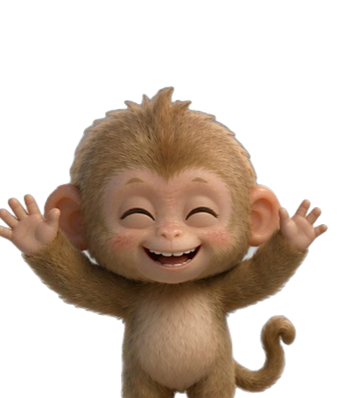
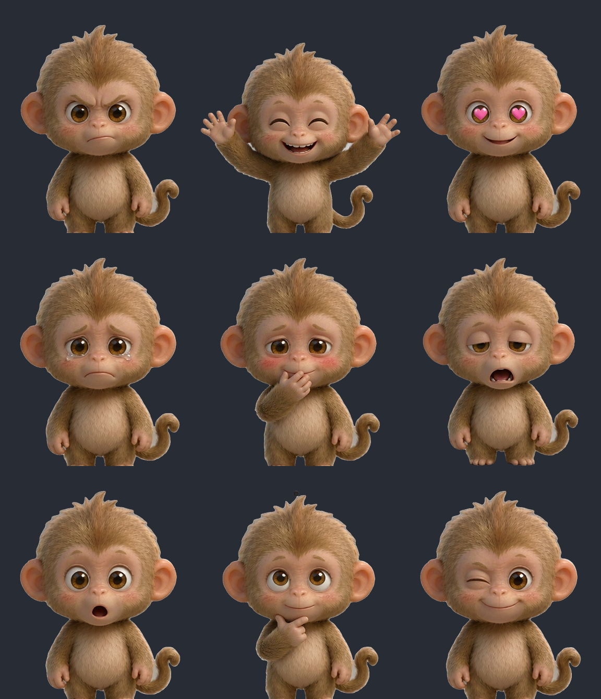

# 🐒 小猴桌宠 · Monkey Pet


一个常驻 Windows 桌面的透明小猴子：会跟着你的鼠标转头、会睡觉、会生气也会害羞，还能当番茄钟、待办本、剪贴板管理器、系统监视器和 AI 助手。

**纯 Electron + 原生 HTML/CSS/JS**，没有前端框架，也没有打包器 —— 逻辑全在 `main.js` / `preload.js` / `renderer.js` 里。

<p align="center">
  
  <br />
  <sub>实际运行时的窗口截图（透明背景，2× 截取）</sub>
</p>

<p align="center">
  
  <br />
  <sub>八向转头 + 9 种情绪（素材预览）</sub>
</p>

## 目录

- [功能](#-功能)
- [快捷键](#-快捷键)
- [快速开始](#-快速开始)
- [配置](#-配置)
- [更换形象](#-更换形象)
- [甩动：牵引 → 松手 → 惯性 → 撞墙](#-甩动牵引--松手--惯性--撞墙)
- [喝酒：酒瓶为什么这样画](#-喝酒酒瓶为什么这样画)
- [技术实现](#-技术实现)
- [目录结构](#-目录结构)
- [常见问题](#-常见问题)

## ✨ 功能

### 桌面陪伴

| | |
|---|---|
| 转头朝向 | 走动时朝行进方向、待机时自己环顾一圈；禁用背面帧，永远不会背对你 |
| 平滑切帧 | 17 张素材靠透明度交叉淡入，没有硬切 |
| 情绪系统 | 生气 / 开心 / 喜欢 / 难过 / 害羞 / 困 / 惊讶 / 思考 / 眨眼 |
| 自动睡眠 | 系统闲置 45 秒睡着，键盘鼠标一动就醒 |
| 整点问候 | 早、中、下午、晚、深夜五套台词，启动时也会打招呼 |
| 撸它 | 鼠标在身上左右快速来回划，会害羞或开心 |
| 分区反应 | 摸头是害羞，戳身子是惊讶后弹回来——点哪儿不一样 |
| 自己做动作 | 空闲时自己决定要做点什么，7~18 秒才来一次，不会一直动 |

### 桌面行为

- **自己散步**：空闲 45 秒~2.5 分钟后在桌面上走去别的地方，起步加速、到点收步，不是匀速平移
- **甩它出去**：抓着快速一甩，松手后它带着惯性飞出去，撞到屏幕边缘反弹，撞几下自己停下。抓着甩的时候它不会钉在光标上，而是被拉在后面荡（手越快落后越多，手一停就追回来）
- **甩晕它**：抓着快速左右来回甩，头顶转圈、眼睛变螺旋、身体发晃，2 秒后自己缓过来
- **边缘吸附**：拖到屏幕边缘 16px 内松手自动贴边
- **贴边半隐藏**：停靠 4 秒后缩成一条，鼠标移上去自动探出来
- **防打扰**：检测到前台全屏（游戏 / 全屏会议 / 全屏视频）自动隐藏，退出全屏自动回来
- **点击穿透**：一键让鼠标穿过小猴点到后面的窗口
- **记忆**：位置、大小、各项开关全部持久化；单实例运行，重复启动只聚焦已有窗口

### 动作系统

16 个关键帧动作，全部由 `character.json` 里的关键帧表驱动，改数值就能重做动画，不用动代码。

| 类别 | 动作 |
|---|---|
| 随机自主 | `lookAround` 东张西望、`curious` 歪头看你、`stretch` 伸懒腰、`hop` 蹦两下、`nod` 点头、`shakeHead` 摇头、`crouch` 蹲一蹲、`shiver` 抖一抖、`doze` 打盹、`waveHand` 挥挥手、`yawn` 打哈欠、`peek` 探头看 |
| 事件触发 | `headTap` 摸头、`bodyTap` 被戳、`land` 落地、`turn` 转身 |

#### 困难的地方：单张位图没有关节

素材是一张 PNG，没有骨架。整只猴子一起平移/缩放的时候，「点头」「摇头」「歪头」「伸懒腰」在别人眼里全是**同一个动作**：整只晃了一下。这是最初版本最致命的问题 —— 16 个动作的数据都在动，可是没人分得出来。

能用来区分动作的手法只有三种：

| 手法 | 通道 | 适合表达 |
|---|---|---|
| ① 切帧 | `frame` | 正面 / 侧身 / 侧 3/4，以及 9 张情绪脸（`e_cheer` **双臂上举**、`e_shy` 手掩嘴、`e_thinking` 手托下巴、`e_sleepy` 张嘴） |
| ② 整只 | `dx` `dy` `rot` `sx` `sy` | 重心移动、挤压拉伸、跳跃、下蹲 |
| ③ 只动头 | `headRot` `headDx` `headDy` `headSx` `headSy` | 点头、摇头、歪头、低头打盹、探头 |

所以每个动作都**指定了它独占的手法组合**，没有一个动作是"整只晃一下"凑出来的：

| 动作 | 主要靠什么区分 |
|---|---|
| `lookAround` 东张西望 | 侧脸帧 + 头左右转 6° + 头横移 2.6% |
| `curious` 歪头看你 | 头歪到 11°，身子几乎不动（头/身幅度比 6.9 倍） |
| `stretch` 伸懒腰 | `e_cheer` 双臂上举 + 全身拉长 6% + 头仰起 |
| `hop` 蹦两下 | 两段独立抛物线，空中换成 `e_cheer`，落地压缩到 0.92 |
| `nod` 点头 | 只有头在压：`headSy` 缩到 0.91，连点三下 |
| `shakeHead` 摇头 | 只有头在转：±9.5° 左右四次，身子反向带一点 |
| `crouch` 蹲一蹲 | 全身沉 3.6% + 压扁到 0.91 + 停住两秒 |
| `shiver` 抖一抖 | **快**：0.9 秒抖 7 个来回（摇头是 1.3 秒 4 次） |
| `doze` 打盹 | 换 `e_sleepy` + 头一点点垂到底 + 猛地惊醒 |
| `waveHand` 挥挥手 | `e_cheer` + 举起来之后原地摇三下 |
| `yawn` 打哈欠 | 换 `e_sleepy`（张嘴那张）+ 头后仰 + 全身拉长 |
| `peek` 探头看 | 头**先**探出去，身子后跟上；侧脸帧 |
| `headTap` 摸头 | `e_shy` 手掩嘴 + 头被按下去（`headSy` 0.90） |
| `bodyTap` 被戳 | `e_surprised` → `e_cheer` → `e_wink` 三连 |
| `land` 落地 | 压到 0.90 再回弹 |
| `turn` 转身 | 侧 3/4 帧 + 横向压扁；全表唯一不碰头通道的动作 |

> 头层是怎么切出来的：逐行统计轮廓宽度，**最窄的那一行就是下巴和肩膀之间的脖子**（本图在 y=0.652，宽 0.302 窗宽）。用一条带羽化的横向蒙版把上半截再叠一层，头就能单独转。旋转支点必须取**头心**而不是脖子 —— 绕脖子转会让整个头的轮廓平移出去十几像素，转过的和没转过的两条轮廓叠在一起，看着像"头变宽了一圈"；绕头心转则圆形轮廓几乎不动，只有耳朵和呆毛在转，那才像歪头。缩放支点反过来必须取脖子，这样"头缩一下"是朝脖子压。两个支点分属两层（`#head` / `#headSpin`），互不影响。重量方法见 `tools/measure-neck.py`。

五条让它显得"活"的规矩：

1. **走动由位移驱动步频**，不是由时间驱动。走过多少像素就迈多少步 —— 窗口移动快脚步就快，停下脚步就停，脚始终踩在正确的地面位置上，不会打滑。
2. **起伏只发生在地面线以上**。落脚那一刻是静止高度（`dy = 0`），两脚之间抬到最高（`-bob`）；不要写成"落脚时往下沉一个 bob"。素材的脚底往往正好压在图片最后一行（本形象底部留白 0px），任何"往下沉"都会被窗口底边整块切掉，用户看到的就是"走路时脚不见了"。
3. **动作之间留白**。每两个自主动作之间静默 7~18 秒，同一个动作 40 秒内不重复；实在挑不出就这一轮不播，宁可不演也不破坏节奏。
4. **姿态分层合成**，每层只改自己的 `transform`，互不抢：`#gait`（步态起伏挤压）/ `#pose`（醉拳瞌睡）/ `#lean`（仰头前倾）/ `#head`（只动头）/ `#breath`（呼吸）。所以走路时被戳、喝酒时被摸头，动作可以叠加而不会互相覆盖。
   > 原来最外层还有一层 `#tilt` 做「跟随鼠标的伪 3D 透视」。它不参与姿态，却在最外面套了一层 `perspective + rotateX/rotateY`，和正在播的动作抢画面（喝酒要仰头、眩晕要摇晃、抛飞要后仰，全被那只追光标的手按住不放），所以整条链路已经删掉，见下面「为什么把『看向鼠标』删掉」。
5. **每个动作都要过"看不看得出来"的检查**。单测会按 192×223 折成像素，算每个动作各项手法的幅度够不够 1 个像素级；还会两两比较姿态曲线，几乎一样的直接判失败。数值调小了会当场报警，不靠肉眼发现。

#### 眩晕为什么不能挂在 `#stage` 上

眩晕曾经是两件事：身体晃（`#breath` 上挂 `dizzyWobble`）+ 头顶一个转圈的黄色螺旋（`#swirl`）。前者没问题，后者挂错了地方 —— `#swirl` 是 `#stage` 的直接子元素，也就是**窗口坐标系**，它根本不在 `#gait → #pose → #lean → #breath` 这条变换链里。于是眩晕一开始晃，头在动、螺旋不动，那个圈就慢慢飘离眼睛，看着像贴在屏幕上的一张纸。

现在螺旋搬进了眼球：位置和尺寸都取 `character.json` 的 `eyes.points`（和眼球同一个锚点），`.eye` 的 `overflow: hidden` 负责裁切。所以"只在眼睛区域内显示"是**结构保证**的，不是靠调坐标凑的。

两个坑，都不是"调调数值"能解决的：

1. **`.eye` 的居中靠 `transform: translate(-50%, -50%)`，所以旋转动画只能挂在里面的 `svg` 上。** 一旦把 `animation: dizzySpin` 挂到 `.eye` 上，动画会整条覆盖 `transform`，那半个身位的位移直接丢失 —— 眼球当场往右下角窜。这种"偏移"跟挂错父元素长得一模一样，但根因是 `transform` 被覆盖。
2. **隐藏窗口不跑动画帧。** 连采两次 `getComputedStyle(el).transform` 会拿到一模一样的角度，看着像"动画没生效"。要验它真的在转，得用 Web Animations API 把时间轴定死：`getAnimations()[0].currentTime = 450` 再读，跟窗口可不可见无关。

还有一条尺寸上的硬约束：眼球只有 27×23 px，螺旋每转一圈半径才前进 `(r1-r0)/圈数`。**圈数一多，相邻两圈的白缝就比线宽还窄，整只眼睛糊成一个黄甜甜圈**（2.55 圈 / 2.5px 就是这样）。1.6 圈时缝宽 ≈ 2.6 单位，比线宽 1.9 还宽，这才是"看得出是螺旋"的下限。

验证在 `tools/eye-probe.js` + `tools/test-eyes.cjs`（9 条，三档窗口 192/288/384）：眼球中心和尺寸必须等于 `eyes.points × 层尺寸`（实测误差 0.01px）、图形铺满眼球、`overflow` 是 hidden、旋转支点在眼球中心、半圈正好转 180°、居中那条 `transform` 没被吃掉。

#### 为什么把「看向鼠标」删掉

原来的待机行为是：光标往哪偏，小猴就转侧脸 + 做一层 `perspective(700px) rotateY(±14°) rotateX(±14°)` 的伪 3D 倾斜。**它是和所有动作同时生效的**，所以每一种"有姿态的动作"都在跟它打架：

- 喝酒要仰头（`#lean` 的 `--leanA` -6.5°），可透视层还在外面转；
- 眩晕要左右摇（`#breath` 的 `dizzyWobble`），透视层的旋转把摇晃的幅度盖掉一半；
- 抛飞要后仰、要撞墙压扁，透视层又按光标的方向把整只人掰向另一边。

根因是**位置**：`#tilt` 是 `#stage` 的直接子元素，在整条变换链的**最外层**。它不是一个动作，而是"套在所有动作外面的一层视角"，优先级天然高于任何单个动作。所以修法不是"动作播的时候暂停倾斜"（那只是把冲突时间挪到进出动作的两个瞬间），而是整条删掉。

删掉之后姿态只由 `#gait / #pose / #lean / #head / #breath` 五层决定，每一层都属于某个具体动作，没有"全局视角"这一层。

配套的连带改动：

- 「朝向」现在只有两个来源 —— **走动时朝行进方向**（`pose.facing`），**待机时自己环顾一圈**（`pickMood`）。走完必须显式 `dirK = 0` 回正脸，因为以前这一步是"问主进程现在鼠标在哪"，现在没人可问了。
- 光标通道**保留**但降级：它只喂「撸它」（鼠标在身上快速来回）和「把睡着的叫醒」，渲染层拿到 `dx, dy` 不再改任何 `transform`。不能整条删掉 —— 透明区域的窗口是穿透的，收不到 DOM `mousemove`，删了「撸它」就死了。
- 抽烟/喝酒期间那个 7°/-2° 的"望远方"倾斜一并消失。忧郁感改由 `#lean` 的 `tiltback`（吐烟轻仰）和 `#pose` 的 `poseSlump` 承担 —— 都是真姿态，不是假视角。

### 效率工具

| 工具 | 说明 |
|---|---|
| 🍅 番茄钟 | 25 分钟专注，每分钟播报剩余时间，结束弹系统通知 |
| 📝 今日待办 | 独立编辑窗口，气泡查看；**没做完自动顺延到明天**，完成后不再出现 |
| 🔔 未完成提醒 | 每 10 分钟用气泡列出还没做完的任务，全部完成即停，可当天静音 |
| 📋 剪贴板历史 | 保留最近 50 条，可搜索，回车即复制回剪贴板（仅内存，退出清空） |
| 📊 系统监控 | CPU 占用、内存用量、网络上下行实时速度 |
| 📚 课程 / 日程 | 每周课程 + 一次性日程，提前 N 分钟用气泡提醒 |

### AI

| 能力 | 说明 | 需要 Key |
|---|---|---|
| 💬 对话 | 任意 OpenAI 兼容接口，回答走小猴气泡风格 | ✅ |
| 🪪 名片识别 | 把名片图片拖到小猴身上，抽成结构化字段（姓名/公司/职位/电话/邮箱/地址/网址），可一键复制 JSON | ✅ 视觉模型 |
| 📄 PDF 论文解析 | 拖入 PDF 或 `Ctrl+Shift+D`，抽出**研究问题 / 研究方法 / 主要结论 / 关键贡献**，可看 JSON、复制、导出 Markdown | ❌（配了更准） |
| 🔊 语音朗读 | 用系统 TTS 朗读回复、早报和提醒 | ❌ |
| 🌤 每日早报 | 天气 + 一条热点，可设定每天自动播报 | ❌ |

> 完整用法、常见问题见 **[usage.html](usage.html)**（应用内：右键小猴 →「功能说明 / 快捷键」）。

## ⌨️ 快捷键

| 快捷键 | 功能 |
|---|---|
| `Ctrl+Shift+P` | 点击穿透开关 |
| `Ctrl+Shift+H` | 显示 / 隐藏小猴 |
| `Ctrl+Shift+T` | 开始 / 停止专注（25 分钟） |
| `Ctrl+Shift+O` | 今日待办 |
| `Ctrl+Shift+V` | 剪贴板历史 |
| `Ctrl+Shift+M` | 系统状态 |
| `Ctrl+Shift+K` | 课程 / 日程 |
| `Ctrl+Shift+A` | AI 对话 |
| `Ctrl+Shift+U` | AI 设置 |
| `Ctrl+Shift+R` | 立即生成每日早报 |
| `Ctrl+Shift+D` | PDF 论文解析 |

## 🚀 快速开始

**环境要求**：Windows 10/11、Node.js 18+

```bash
git clone https://github.com/hou13851865503-design/monkey-pet.git
cd monkey-pet
npm install
npm start
```

打包成安装包（NSIS）：

```bash
npm run dist
```

产物在 `dist/`。首次运行会出现在屏幕右下角，托盘也有图标。

跑回归测试（不需要开窗口，纯 Node）：

```bash
npm test
```

`tools/test-anim.cjs` 里有 59 条针对姿态引擎的断言，覆盖步频是否真的由位移驱动（走完一个 stride 正好一步、窗口放大一倍步数不变）、**走路时脚会不会被窗口底边裁掉**（全程 `dy` 不许为正、每个动作的下沉量不许超过 `footRoom`）、掉头是否重置相位、动作播完是否回待机、落地挤压是否随冲击变大、**抛飞时后仰方向是否跟着速度走**（撞墙反向后必须换边）、以及**换形象后动作语义是否不变**。改了 `character.json` 或 `anim.js` 之后先跑这个。

`tools/test-flight.cjs` 有 15 条针对抛飞物理的断言，全部在守那三条不变式：200 组随机初速 + 1e6 px/s 都不许出工作区、任意初速 9 秒内必须停下且速度归零、撞角要同时记录两个轴、连续甩 500 次不许攒出 NaN 或偏移、60fps 与 30fps 的收敛时间差小于 5%。

单测只能证明"数值变了"，证明不了"人看得出来"。所以还有几个真机钩子（环境变量，跑完自己退出，可以和正在运行的桌宠并存）：

| 钩子 | 作用 |
|---|---|
| `PET_TEST_STRIP=lookAround,nod` + `PET_TEST_STRIP_T=0,0.25,0.5,0.75` | **定格取帧**：按归一化时间把动作定格后各截一张。快频动作（抖一抖 0.9 秒抖 7 个来回）按时间截图会对不准相位，这个不受时钟影响 |
| `PET_TEST_CLIPS=a,b,c` + `..._N=5` | 按真实时间连播并各截 N 张，检验"录下来"的观感 |
| `PET_TEST_CLIP=nod` | 播一次并打印每 80ms 的姿态（含头层在 DOM 上生效的 transform），确认"引擎→DOM"这条链成立 |
| `PET_TEST_TAP=head` | 注入一次点击，验证命中盒→分区反应 |
| `PET_TEST_WALK` / `PET_TEST_DRAG` | 散步 / 拖拽 |
| `PET_TEST_THROW` | **甩动全链路**：先白盒验"慢放不抛 / 快甩才抛"，再按 5 组初速各飞一次（斜、左、上、撞角、连甩十次后收尾），检查有没有出界、撞没撞墙、停不停得下来、窗口尺寸有没有被 DPI 拖着长胖 |
| `PET_TEST_THROW_SHOTS=1` | 飞行中截 3 张，并把 `#gait` 的 transform 字符串一起打出来 —— 引擎算得再对、CSS 没贴上也是白算 |

截图配合 `python tools/sheet.py out.png <动作id...>` 拼成一张对比表，一眼就能看出哪些动作其实长得一样。

> 量"脚有没有出界"时有两个坑，都踩过：① `#breath` 上有 `drop-shadow`，投影会一直渗到窗口最底一行（alpha 只有 20~50），按 `alpha > 8` 数像素会把**投影当成脚**，结论正好反了 —— 要用 `alpha > 128` 数实体；② 将来若又有人在最外层套一层透视（`perspective + rotate3d`），子元素的包围盒会比视口高几个像素，那时不同时刻截的图就不能直接比「离底还剩几 px」，要连着 `layers=...` 一起看（`PET_TEST_WALK` 的日志里有）。

> 已知代价：头层是"完整底图 + 旋转的整体再叠一层"，两者不完全重合，所以头转开的那一侧会留下一条**淡淡的双轮廓**。1 倍尺寸（192×223）看不出来；放大到 2 倍以上能看见。这是单张位图做局部旋转的固有代价 —— 要么留双轮廓，要么转动时露出一个洞，选了前者。

## ⚙️ 配置

右键小猴 →「AI 设置」，接入 **WorkBuddy API**（OpenAI 兼容协议）：

**最快的方式**：点「一键自动接好」。它会探测本机能用的接口（本机 Codex 中转 `127.0.0.1:8787`、Ollama、LM Studio 等），探到就自动填好、存盘，并立刻发一条测试请求确认能通。

手动填的话：

| 字段 | 说明 | 示例 |
|---|---|---|
| Base URL | 填到 `/v1` 为止，程序自己补 `/chat/completions` | `https://<你的接口地址>/v1` |
| API Key | 对应服务的 Key | `sk-...` |
| 模型 | 优先 `DeepSeek-V4.1-Flash`；接口上没有就自动换成可用的并告诉你 | `DeepSeek-V4.1-Flash` |
| 超时 / 重试 | 默认 25000ms / 2 次，只对限流、5xx、网络异常重试 | `25000` / `2` |

> ⚠️ `DeepSeek-V4.1-Flash` 是 WorkBuddy 平台内的模型，没有对外的 API 可直连。想在桌宠里用它，需要拿到某个兼容 OpenAI 协议的服务商提供的 Key；否则自动接入会用本机已有的通道（如 GPT 系列）。

- **没配也能用**：对话、名片识别提示去配置，PDF 论文解析自动降级成规则抽取，桌宠本身照常跑。
- **点「测试连接」**会发一条极小请求，失败时直接显示错误码（`auth` / `model-not-found` / `network` / `timeout`…），不用猜。
- 地址末尾多一个 `/` 会被拼成 `//chat/completions`，已经写到 `/chat/completions` 的又会被重复拼——这两种情况 `wb.js` 都兜住了。
- 所有设置（含 Key）保存在 `%APPDATA%\monkey-pet\settings.json`，**不会进入仓库**。
- 出网请求走 Electron `net` 模块，会自动使用系统代理；访问需要代理的接口前请先开启代理。

## 🔄 更换形象

想换成猫、狗、兔子，或者自己画一套图？

**只需要改 `character.json`，一行代码都不用动。** `anim.js` 里没有任何 `192`、`0.38`、`223` 这样的硬编码数字，所有比例量都从档案读，因此换窗口尺寸或换动物都不会让动作失真。

```jsonc
{
  "size": [192, 223],              // 窗口尺寸，改这里同时改 main.js 的 WIN_W/WIN_H
  "frames": {
    "front": "d0",                 // 正面帧
    "side": "d2",                  // 侧身帧：走路时用（静止帧配步态起伏才不滑）
    "turnA": "d1",
    "emotions": { "angry": "e_angry", "cheer": "e_cheer" /* ... */ }
  },
  "anchors": {
    "foot": 0.995,                 // 脚底支点（0~1，按高度算）：旋转和挤压都绕这里发生
    "headCenter": [0.38, 0.28],    // 转头时的旋转中心
    "headCut": 0.652,              // 头层的切线：脖子所在的那一行（轮廓最窄处）
    "headPivot": [0.573, 0.707],   // 位移/缩放的支点：脖子中线，必须在切线下方
    "headSpin": [0.568, 0.38],     // 旋转的支点：头心。绕脖子转会变成"头变宽了"
    "headFeather": 0.03,           // 切线附近的羽化宽度，让重叠区变成很淡的残影而不是硬边
    "footRoom": 0.032              // 底部安全余量：脚还能往下沉多少（留白 0 时也必须给）
  },
  "props": {                       // 道具几何（叼烟等），支点是对应那张脸的嘴角
    "cig": {
      "frame": "e_sleepy",         // 抽烟用哪张脸：必须是张着嘴的
      "at": [0.545, 0.622],        // 烟屁股扎进嘴里的那一点
      "deg": 72,                   // 相对竖直方向的倾角（顺时针为正）
      "len": 0.15,                 // 露出嘴外的长度（占窗高）
      "width": 0.028,              // 粗细（占窗宽）
      "burnSpan": 0.12             // 烧完一整根能缩短多少
    }
  },
  "zones": [                       // 命中分区：打点落在哪个矩形里就给哪个反应
    { "id": "head", "box": [0.24, 0.03, 0.80, 0.46], "reaction": "headTap" },
    { "id": "body", "box": [0.14, 0.46, 0.94, 1.00], "reaction": "bodyTap" }
  ],
  "eyes": {                        // 眩晕时盖在眼睛上的卡通眼球（每项都是比例）
    "ink": "#2f2116",              // 螺旋线条颜色
    "points": [                    // x/y = 眼球中心，w/h = 椭圆大小
      { "x": 0.47526, "y": 0.47657, "w": 0.14344, "h": 0.10621 },
      { "x": 0.66276, "y": 0.47657, "w": 0.14344, "h": 0.10621 }
    ]
  },
  "gait": {                        // 步态幅度，全部是"占窗口尺寸的比例"
    "speed": 0.62,                 // 每秒走多少个窗宽
    "stride": 0.34,                // 一个完整步周期走多少窗宽
    "bob": 0.024, "sway": 0.013,   // 上下起伏 / 左右摇摆幅度
    "leanDeg": 3.2, "rockDeg": 1.1,// 前倾角 / 每步左右晃动角
    "squash": 0.06,                // 落脚挤压量
    "accel": 0.18                  // 梯形速度曲线的加减速段长度
  },
  "schedule": { "gapMin": 7000, "gapMax": 18000, "cooldown": 40000 },
  "clips": [ /* 动作关键帧表，见下 */ ]
}
```

**比例量全部以窗口为基准**：位移用宽、起伏用高。窗口从 192×223 放大到 384×446，`dy: 0.02` 自动从 4.4px 变成 8.8px，观感一致，不用调参。

一个动作长这样 —— 关键帧只写你要改的通道，没写的通道保持原值，不会被拽回中性位：

```jsonc
{ "id": "nod", "label": "点头", "dur": 1200, "tags": ["quiet"], "weight": 2,
  "keys": [
    { "t": 0 },
    { "t": 0.14, "headSy": 0.912, "headRot": 3.4, "headDy": 0.005, "dy": 0.008, "sy": 0.99 },
    { "t": 0.30, "headSy": 0.996, "headRot": 0, "headDy": 0, "dy": 0, "sy": 1 },
    { "t": 0.44, "headSy": 0.912, "headRot": 3.4, "headDy": 0.005, "dy": 0.008, "sy": 0.99 },
    { "t": 1.00 }
  ] }
```

通道分两组：

| 组 | 通道 | 作用范围 |
|---|---|---|
| 整只 | `dx` `dy`（位移，占窗口宽高的比例）、`rot`（角度）、`sx` `sy`（缩放） | 整只动物 |
| 只动头 | `headRot` `headDx` `headDy` `headSx` `headSy` | 脖子上方那一层 |

两组分别贴到 `#gait` 和 `#head` 两个不同的层，互不覆盖，所以可以同时"身体下沉 + 头往下点"。另外可以在关键帧上写 `"frame": "e_shy"` 切表情帧，这个值是离散的，只取不晚于当前时刻的最后一个声明。

`tags` 里带 `reaction` 的动作**不进随机池**，只能被事件（点击、落地）唤起。

**换一整套图的操作步骤**：

1. 把新素材切成同名帧（`d0`~`d7` 八向 + `e_*` 情绪），放进 `assets/`
2. 改 `character.json` 的 `size`、`frames`、`anchors`、`zones`
3. 按新形象的腿长调 `gait.stride`（短腿就调小，不然会像滑冰）
4. **量底部留白**（脚不能出界）：`python tools/measure-neck.py assets/01.png`，它会顺手报出最低一行实体像素到图底边的距离，并给出建议的 `footRoom`。**本形象是 0px** —— 脚底正好压在图最后一行，所以任何下沉都会被窗口裁掉，`footRoom` 必须给足（下限 0.032，要兜住最深的下沉动作 0.021 加上旋转时最低那个角；真机量过：0.026 时蹲到底那一帧余量正好是 0）。新素材如果本身就留了白，把报出来的留白加进这个下限里
5. **重量脖子**（头层要用）：`python tools/measure-neck.py assets/01.png --preview neck.png --out character.json`。它找轮廓最窄的一行，也就是下巴和肩膀之间的脖子，同时给出旋转支点。看一眼 `neck.png`：洋红线要正好压在下巴下沿，不能高到脸上、也不能低到胸口
6. **重量眼睛**（眩晕要用）：`python tools/measure-eyes.py assets/01.png --preview eye.png --out character.json`，然后**一定看一眼 `eye.png`** —— 眼球椭圆边缘外不能露出棕色虹膜或灰白眼白，露出来就会像多长了一只眼
7. **重量叼烟**：改 `props.cig` 的 `frame`（挑一张张着嘴的脸）和 `at`（对齐那张脸的嘴角内侧），再调 `len` / `deg` 让火头落在眼睛下方。`npm test` 里有断言会算火头到眼睛下缘的距离，少于 3.5% 窗高就报错
8. **补侧脸体积**：`python tools/fill-face.py assets/03.png --write`，再 `python tools/fill-face.py assets/03.png --check` 确认吻部真的顶出来了（下面单独讲）
9. **重量甩动手感**（可选）：窗口尺寸变了就顺手调 `throw.physics.minThrow` 和 `stopSpeed` —— 这两个都是 px/s，窗口小一半就按比例调小，否则轻轻一甩够不到阈值、甩不动了。单测只守物理不变式（不出界 / 一定停 / 不穿墙），"甩起来爽不爽"只能靠 `PET_TEST_THROW_SHOTS=1` 真机看
10. `npm test` —— 里面有断言在检查"换形象后动作语义不变""眩晕眼几何合法""火头没戳到眼睛""头层切线在眼睛下面""走路时 dy 不许为正""抛飞后仰方向跟着速度走"

> 第 4~8 步为什么要单独量：这几处都是"正好贴边"的活 —— 脚底贴窗口底边、切线贴在脸上、眼球贴着虹膜、烟头贴着眉骨。位置写死在 CSS 里的时候，素材一换、甚至只是量偏 2%，脚就被裁掉、原来的虹膜就从边缘露出来（看着像多长了一只眼）、烟一长就顶到眼球高度（看着像烟烧进眼眶）、头层切线高一点就把眼睛切成两半。这几个坑都踩过，所以几何现在都进档案、都有断言守着。

**叼烟为什么是横着斜出去、不是竖着往上叼**：这只猴子的嘴在 62% 高度、眼睛下缘在 53%，中间只有 9% 的竖直空间。烟一旦接近竖直，火头必然顶到眼睛 —— 原来的参数（17% 长、26° 倾角）火头正好落在 47.2%，也就是眼球中心的高度。改成 72° 几乎横着、15% 长之后，火头落在脸颊上、眼睛下方约 4.6%。换形象时 `len` 和 `deg` 要按新脸的五官间距重调，别照抄。

### 侧脸为什么显得扁，怎么补的

侧脸（`d2` = `03.png`）是走路时唯一的帧，所以它扁不扁，直接决定这只宠物看起来"有没有厚度"。

量一下就知道问题在哪：把每一行最右侧的实体像素连起来就是侧脸轮廓，取三个点（384 宽下）——

| | 眉弓 | 眼窝 | 吻部 |
|---|---|---|---|
| 原始素材 | 293 | 289 | **297** |
| 补过之后 | 294 | 291 | **305** |

原始素材里**吻部只比眉弓凸 4px**，几乎就是一条竖线，所以从侧面看像一张纸。真猴子的侧脸一定
是"眉弓—眼窝凹—吻部凸—下巴收"的起伏，落差至少是脸宽的 1/10。

补的办法是**逐行把轮廓推出去**（`tools/fill-face.py`）：

1. **轮廓推移**：对每一行 y 取外缘 `x_edge(y)`，把 `[x_edge-band, x_edge]` 这一段整体向右推
   `delta(y)`，`delta` 由控制点插值（吻部 +0.165 个脸长 ≈ 9px，脸颊 +0.08，眉弓 +0.018，
   **眼睛那一行只给 +0.008** —— 远眼就贴在轮廓边上，推多了会把远眼挤歪）。权重在轮廓上严格
   等于 1、往里 `band` 处降为 0，所以轮廓确实动了，而不是只把表面揉花。
2. **造型光**：眉骨下的眼窝阴影、鼻唇沟、吻部顶面转折、下巴与脖子的缝，各压一点点；颧骨和
   鼻梁各给一块高光。**体积感八成靠这几道明暗**，形变只负责把边顶出去。
3. **补锐化**：重新采样会把毛发"抹平"，所以末尾补一道半径 1px 的 unsharp —— 毛发是这张图的
   主要质感，糊了整只都会显假。

三条硬约束，改参数前先读：

- **眼睛一个像素都不能动**。形变在眼区权重强制为 0（`fill_face` 里的 eye guard）。眼睛是全图
  最精致的部分，偏 1px 就散神 —— 比"脸鼓不鼓"严重得多。
- **位移超过 10px 就露馅**。384 宽下 9px 已经是上限，再多毛发会明显拉丝，2 倍尺寸一眼看出
  "被橡皮推过"。要更鼓就往明暗上加，别往位移上加。
- **不要连跑两次**。工具不是幂等的：对已经处理过的图再跑一遍会继续往外推。要重做先
  `git checkout assets/03.png`。

觉得不够鼓或过头了，用 `--strength 1.2 / 0.8` 整体缩放（形变和明暗一起缩放），07 那张更贴近镜头的帧就是用 0.75 跑的。

`--check` 会把上面那三个点量出来，`吻部 - 眉弓 ≥ 8px` 且 `吻部 - 眼窝 ≥ 10px` 才算过 ——
换成"看起来差不多"的糊弄法会当场 FAIL。

改坏了也不会崩：读档案失败时会退化成内置的最小档案（能正常转头、点它会害羞，只是没有那 16 个动作），启动不受影响。档案里没有 `eyes` 段时眩晕只剩头顶转圈 + 身体摇晃，不会硬画一对错位的眼睛；没有 `props.cig` 时抽烟退回内置几何，同样能正常叼。

## 🌀 甩动：牵引 → 松手 → 惯性 → 撞墙

抓着小猴快速甩一下，松手之后它会带着惯性飞出去，撞屏幕边缘反弹，几下之后自己停下。

### 三段式

| 段 | 谁在做 | 做了什么 |
|---|---|---|
| ① 牵引（按住甩） | 主进程 `dragPoll` | 窗口**不钉在光标上**，每 16ms 只往后追一定比例的距离。手越快落后越多（落后量 ≈ 速度 × 时间常数），手一停就追回光标下面 —— "被一根橡皮筋拉着"的手感来自这里 |
| ② 松手判定 | `flight.launch` + `endDrag` | 判定这一下算"甩出去"还是"放下"。两道门同时成立才算甩，见下 |
| ③ 飞行 | `flight.js` + `flyTick` | 每 16ms 推进一帧物理：阻尼衰减 + 撞墙反弹，逐帧 `setPosition`；停下后播一次落地压扁 |

姿态（后仰角、拉伸、撞击压扁、惊讶脸、腾空）全在 `anim.js` 里，主进程每帧把**当前速度**下发过去。只给初速是不够的 —— 撞墙后速度反向，身体必须跟着换边后仰，否则看起来像一张贴着墙往回飘的纸片。

### 松手判定：两道门

```
① 最近 130ms 的速度峰值 ≥ minThrow（1000px/s）
② 松手那一刻的速度 ≥ 峰值的 55%
```

为什么需要两道：**正常拖动后松手时，手往往还在滑行**（300~700px/s）。如果只看松手瞬间的速度，把宠物从 A 拖到 B 这种再普通不过的操作会有相当一部分变成"滑出去一段"，非常烦。加了①②之后：

- 慢慢放到某个位置再松手 → 峰值不够，放下；
- 拖到目标后手还在飘（600px/s）→ 峰值不够，放下；
- 真甩一下（峰值轻松 2000+）→ 飞出去。

### 物理参数（`flight.js`，档案里的 `throw.physics` 可覆盖）

| 参数 | 值 | 作用 |
|---|---|---|
| `damping` | 1.05 /s | 空气阻力，速度按 `v *= exp(-k·dt)` 衰减 |
| `restitution` | 0.74 | 撞墙后保留多少法向速度（撞一次剩 55% 动能） |
| `wallFriction` | 0.94 | 撞墙时切向也掉一点，否则贴着墙飞会像冰球一样擦过去 |
| `stopSpeed` | 110 px/s | 低于它就判定停下 |
| `maxSpeed` | 3200 px/s | 抛出速度上限，防止暴力一甩让窗口瞬移 |
| `substepPx` | 6 px | 物理分步的位移上限 —— **决定穿不穿墙，别调大** |

### 三条不变式（`tools/test-flight.cjs` 逐条钉住）

1. **永远不出工作区**。边界清晰不是"撞了再修"，而是"分步积分 + 逐轴钳制"。3200px/s × 16ms = 51px，一步就能从墙内跳到墙外，所以按单步位移 ≤ 6px 切分。测试里连 1e6 px/s 和 200 组随机初速都跑过，任何一帧都不许出界。
2. **一定停得下来**。指数衰减永远到不了 0，所以再叠一条"低于 `stopSpeed` 就地停"+ 一条"总时长 9 秒上限"。少了任何一条，被反复甩的宠会在几分钟后攒出"看着静止、其实永远在抖"的状态，而且每帧都在 `setPosition` 白烧 CPU。
3. **撞墙不只是翻符号**。法向衰减 + 切向摩擦，撞角时两个轴都要记录（渲染层拿最狠的那一次做压扁）。

### 甩动暴露出来的一个老 bug：小猴越拖越大

`lockSize(w, h)` 原来是拿 `getBounds()` 回喂的（拖拽开始/结束、贴边、抛飞各调一次）。这台机器 `scaleFactor = 1.785`，而 Windows 无边框 + `resizable` 窗口的 `getBounds()` 比客户区大 5px（隐形拖拽边框），`setMinimumSize` 认的却是客户区 —— 于是每次"读回尺寸 → 锁住它"都会把窗口放大 1~2px。**实测每移动一次长 1.4px**，20 次从 197 长到 228。

甩动一次要 `setPosition` 上百次，这个棘轮立刻从"几乎看不出来"变成"十六次甩动后小猴胖了一圈"，老测试才把它逮到。修法：锁定值只来自**设计尺寸**（`sizeForZoom()` 的结果），永远不用 `getBounds()` 回喂。固定锁定值时尺寸只会在 ±1 之间来回摆，不发散。对照实验：`electron tools/probe-locksize.js --no-sandbox`。

## 🍶 喝酒：酒瓶为什么这样画

喝酒这套动作（举瓶 → 三下咕咚 → 放下 → 回味 → 醉或困）本身不难，难的是**瓶子里的酒**。

原来的写法只有一层：酒液是瓶子的子元素，瓶子转到哪它跟到哪。瓶子举到 -138° 时酒液也转了 -138°，于是酒全"浮"在翘起来的瓶底那头，瓶口这边反而是空的 —— 看着像在喝空气，而且瓶子越斜越明显。

### 三条规则，缺一条就假

| 规则 | 做法 |
|---|---|
| ① **液面永远水平** | 真实液面只认重力、不认容器。酒液按 `-(瓶身倾角 + 祖先链自转)` 反向转回来 |
| ② **酒往低处流** | 液面水平之后"灌满哪一半"是自动的：瓶子朝下时酒积在瓶口。同时**瓶颈里也得有酒**，否则等于瓶口在空气中倒酒 |
| ③ **越喝越少、越喝越仰** | 每吞一口液面掉一格（`--sip`）；最后一口把瓶底竖得更高（-138° → -152°），见底了得仰着才够得着 |

②里有个免费的好处值得单独说：液面恒为水平，**空气泡就永远待在瓶子的最高处**。直立时它在瓶口，一翻过来它自己跑到瓶底那头 —— 不用写任何"气泡动画"，只要把"填充区域 = 水平面以下"这一条坚持到底。

### 关键：角度必须走变量，而且得是**可插值**的变量

两件事同时成立才动得起来：

1. **自定义属性默认是"离散"的**。写 `transition: --sip .7s` 没用，它只会在中间某一刻硬跳。先 `@property --sip { syntax: '<number>' }` 注册成具体类型，才会像普通属性一样逐帧插值。
2. **角度放变量，不要两边各写一条 `transform`**。瓶身读 `--tilt`，酒液读同一个 `--tilt` 反着转，于是"瓶身转到哪、液面就补到哪"在物理上不可能不同步。要是两边各写 `transform` 再各自加 `transition`，缓动曲线差 1%，转的过程中液面就会歪着晃 —— 那比不补偿更假。

这条链上原来就有一个反例：`#lean`（仰头层）用的是写死的 `transform`，酒液根本读不到它转了多少，只能靠一个手填的 `--leanD: -6.5deg` 去"猜"。平时正好抵消，可一旦 `body.tiltback`（咕咚时头往后一仰，-3.2°）叠上来，后写的规则把 -6.5° 顶掉，液面当场歪 3.3°。现在 `#lean` 也改成 `rotate(var(--leanA)) translateY(var(--leanY)) scaleY(var(--leanS))`，酒液读的是**正在动画中的那一个**，`--leanD` 这个"猜"就删掉了。顺带的收益：`sip` 和 `slump` 同时挂着时，原来的写法会在两套 `transform` 之间硬切，现在只是位移和压缩在过渡。

### 剩两件小事

- **弯月面**：液面上沿给 1px 亮边 + 一圈柔光，而且只在朝上的那一侧（`border-top`），否则像贴纸。
- **咕咚**：`@keyframes wineSlosh` 让 `--slosh` 做衰减振荡（7° → -4.6° → 2.4° → -1° → 0）。只动角度不动位移 —— 角度是尺度无关的，窗口放大也照样对。这是"允许液面歪"的唯一例外。

### 已知取舍

醉汉会左右晃 ±7°（`poseSway` 挂在 `#pose` 上），瓶子和酒液一起晃，液面也跟着歪 7° —— 这一层没补偿。理由：晃得慢（周期 3.2~4.8s）、幅度小，看着就是酒在晃；要把这层也补掉得把三套 `@keyframes` 全改成变量驱动，改动面比收益大。

### 怎么验的

- **`tools/bottle-lab.js`**：把 `index.html` 的**同一份样式**和同一段 DOM 拎出来单独渲染，用 `zoomFactor` 放大、背后叠一层水平参考线（红线上就是世界水平），再按设备像素抠图。真实窗口里酒瓶只有 17×42 CSS px，截图上放大 8 倍全是插值糊掉的颜色块，判断不了液面平不平。`npm run lab` 直接出四态对照图。
- **`tools/test-bottle.cjs`**：读放大台量出来的数字，钉 7 条。核心一条是"整条祖先链的自转加起来之后，液面在世界坐标里必须是 0°"—— 实测 0.0°（像素级拟合斜率也是 0.0°）。其余守手感：直立时颈空、倾倒时颈满、喝得越多液面越靠瓶口、见底那口多仰 14°。

## 🧠 技术实现

- **主进程 `main.js`**：创建透明无边框置顶窗口；用主进程轮询真实光标位置实现拖拽（不依赖渲染端 pointermove）；`resizable: true` + `min == max` 锁死尺寸，让 `setPosition` 生效又不会改变大小（锁定值只来自设计尺寸，不要回喂 `getBounds()`，见[甩动](#-甩动牵引--松手--惯性--撞墙)）；`powerMonitor.getSystemIdleTime()` 做睡眠检测；番茄钟、课程提醒、早报等定时任务都在主进程。
- **预加载 `preload.js`**：只通过 `contextBridge` 暴露白名单 IPC，渲染进程没有 Node 权限（`contextIsolation: true`）。
- **渲染进程 `renderer.js`**：17 张图叠层，靠 `opacity` 过渡实现切帧连贯；`requestAnimationFrame` 做倾斜缓动；手势状态机区分「点击 / 拖拽 / 长按 / 撸」。
- **甩动 / 抛飞 `flight.js`**：纯物理（不碰 Electron，可在 Node 里单独跑测试）。位置 px、速度 px/s、时间**毫秒**（和 `anim.tick`、`walkTick` 一致 —— 一开始写成秒，调用方按毫秒传 16 之后被 `maxStep` 一夹，两种帧率跑出一模一样的速度曲线，却一句报错都没有）。三条不变式：分步积分不许穿墙、一定停得下来、撞墙时法向衰减切向也摩擦。手感参数（后仰、拉伸、压扁）在 `anim.js`，和物理分开：物理要被单测钉住，手感要能随手改 0.01 就去试。
- **姿态引擎 `anim.js`**（~500 行，纯逻辑不碰 DOM）：关键帧采样 + 步态合成 + 动作调度 + 腾空姿态。同时是 UMD 模块，渲染层用 `window.PetAnim`、主进程 `require('./anim')` 用同一份代码算走路时长，两边不会算出不同的答案。**位移驱动步频**是它的核心不变式：`phase += 走过像素 / 一帧应走的像素`，用定时器推相位会让速度一变就打滑，用位移推则脚永远踩在正确的地面位置上。**起伏只在地面线以上**是第二条不变式：落脚 = 静止高度，抬脚才往上，`dy` 还有一道 `footRoom` 的钳制兜底 —— 脚是地面接触点，把它推出窗口的姿态在物理上就不成立。
- **散步调度在主进程**：主进程只决定"去哪、什么时候到"，用 `walkEase` 梯形曲线逐帧 `setPosition`，每帧把实际移动的像素量发给渲染层（`walk-step`）；渲染层拿这个像素量推步频。两边都不猜对方在干什么。
- **角色档案 `character.json`**：尺寸、帧名映射、命中盒、脚底支点、眩晕眼几何、叼烟几何、步态参数、动作表全部外置。换形象只改档案，详见 [更换形象](#-更换形象)。
- **多窗口**：气泡、待办、剪贴板、课程、设置、聊天、名片结果、论文解析、使用说明都是独立窗口，按需创建、关闭即销毁。
- **论文解析 `paper.js`**：纯 Node 模块（不依赖 Electron，可单独跑测试）。`pdfjs-dist` 逐页抽文字 → 按标题行切章节 → 拼成压缩后的 digest → 交给 LLM；没配 Key 时走同一套字段结构的启发式规则。两条路径输出**同构**，前端不需要分支。
- **WorkBuddy API `wb.js`**：纯 Node 客户端，只认注入进来的 transport（Electron 里是 `net.request`，测试里是 Node `http`）。负责地址拼接、错误码分类、限流/5xx/网络异常的重试退避、连续失败熔断，以及把各家不同的回复形态（`content` 字符串 / 分段数组 / `reasoning_content`）归一化。**永不抛异常**，所有失败都返回 `{ok:false, code}`，所以接口挂了也不会拖垮桌宠。
- **每日任务 `daily.js`**：任务只存在"创建那一天"下，`onDate()` 计算某天该看到哪些（没完成的自动顺延），跨天不重置勾选。
- **网络**：统一走 `net.request`，这样能继承系统代理和证书设置。

## 📁 目录结构

```
main.js            主进程：窗口 / 托盘 / 拖拽缩放 / 吸附 / 散步调度 / 定时任务 / AI
preload.js         contextBridge 暴露的 IPC 白名单
renderer.js        小猴渲染与手势
anim.js            姿态引擎：关键帧采样 / 步态合成 / 动作调度（不碰 DOM）
flight.js          抛飞物理：阻尼 / 反弹 / 停下（不碰 Electron，可单独跑测试）
character.json     角色档案：尺寸、帧名、命中盒、支点、步态参数、16 个动作
daily.js           每日任务数据模型（跨天顺延）
paper.js           PDF 论文解析（抽文本 / 切章节 / 规则与 LLM 双路抽取）
wb.js              WorkBuddy API 客户端（地址拼接 / 错误码 / 重试 / 熔断）
index.html         小猴窗口
bubble.html        气泡窗口（提示 / 待办 / 倒计时 / 系统状态）
usage.html         功能速查表
todo.html          今日待办编辑
clip.html          剪贴板历史
schedule.html      课程 / 日程编辑
settings.html      AI 设置
chat.html          AI 对话
card.html          名片识别结果
paper.html         PDF 论文解析窗口
tools/             开发辅助（图标 / 切图 / 前台窗口检测 / 回归测试）
                   gen-clips.py 生成动作表 · measure-neck.py 量脖子与底部留白 · measure-eyes.py 量眼睛
                   fill-face.py 补侧脸体积（轮廓推移 + 造型光）· sheet.py 拼对比表
                   bottle-lab.js 酒瓶放大台（同一份样式 + 水平参考线 + 量液面角度）
                   eye-probe.js 眩晕眼探针（量眼睛盒子的位置/尺寸/支点/旋转）
                   crop-eyes.py 自动框住两只眼睛再放大（对比画法用）
                   test-anim.cjs 引擎回归 · test-flight.cjs 物理回归（不出界 / 一定停 / 撞得对）
                   test-bottle.cjs 酒瓶视图回归（液面恒水平 / 酒往低处流）
                   test-eyes.cjs 眩晕眼回归（挂在眼球上 / 裁在眼球里 / 原地转）
assets/            八向图与情绪图素材
```

## ❓ 常见问题

| 现象 | 解决 |
|---|---|
| 改了代码不生效 | 单实例锁：先右键「退出」再重新打开 |
| AI 请求失败 | 打开「AI 设置」点「测试连接」，按错误码排查：`auth`=Key 不对、`model-not-found`=模型名不对、`network`=没网/没开代理、`timeout`=接口慢 |
| 名片识别无结果 | `DeepSeek-V4.1-Flash` 是纯文本模型，点「改用其他模型」换视觉模型 |
| TTS 没声音 | Windows 设置 → 时间和语言 → 语音，添加中文语音 |
| 论文解析提示「可能是扫描件」 | PDF 里没有可选中文字，需先做 OCR；不配 Key 也能用规则抽取 |
| 网速显示 N/A | PowerShell 的 `Get-NetAdapterStatistics` 不可用，CPU/内存不受影响 |
| 早报获取失败 | 网络或代理问题，天气用 wttr.in、热点用 V2EX |
| 侧脸看起来像一张纸、没有厚度 | 吻部没顶出来：`python tools/fill-face.py assets/03.png --check` 会量出吻部比眉弓凸多少，少于 8px 就跑 `--write` 补一遍（见 [更换形象](#-更换形象) 第 8 步） |
| 走路时脚看不到 / 脚像被切平 | 素材脚底贴死了图底边（留白 0px），`dy` 一往下沉就被窗口裁掉。量一遍底部留白并把 `footRoom` 填够（见 [更换形象](#-更换形象) 第 4 步），别改成"往下沉"的起伏 |
| 轻轻一拖小猴就飞出去了 | `throw.physics.minThrow` 太低（默认 1000px/s），或者 `endDrag` 里"松手时速度还剩峰值的 55%"那道门被去掉了 —— 只看松手瞬间速度的话，正常拖动后手还在滑行就会被当成甩 |
| 甩出去之后撞墙但看着像"贴着墙往回飘" | 渲染层没收到每帧的速度（`throw-vel`），后仰方向还停在上一次。身体必须跟着**当前**速度换边 |
| 小猴越拖越大 / 甩几次就胖了一圈 | `lockSize()` 被回喂了 `getBounds()`。锁定值只能来自 `sizeForZoom()` 的设计尺寸 —— 详见[甩动](#-甩动牵引--松手--惯性--撞墙)最后那节（DPI 取整棘轮） |
| 甩出去之后窗口飞出屏幕 / 卡在任务栏后面 | 物理分步被调大了（`substepPx`）或边界用了 `display.bounds` 而不是 `workArea`。前者会穿墙，后者会盖住任务栏 |
| 喝酒时酒"浮"在翘起的瓶底那头，像在喝空气 | 酒液没有做反向补偿，跟着瓶子一起转了。检查 `.bt-liq` 的 `transform` 里有没有 `-1 * var(--tilt) - var(--leanA)`，以及 `--tilt` / `--leanA` 有没有 `@property` 注册（没注册就不会逐帧插值）。`npm run test:bottle` 会直接报出歪了多少度 |
| 改了 `#lean` 的仰头角度，酒瓶开始歪 | `#bottle` 里**不要**声明 `--leanA` —— 那会把祖先那层正在动画中的值盖掉。仰头角只能从 `#lean` 继承下来 |
| 眩晕的螺旋飘在头顶 / 一晕就离眼睛越来越远 | 特效又挂回窗口坐标系了（`#stage` 的直接子元素）。它必须在 `#eyes > .eye` 里，位置和尺寸取 `character.json` 的 `eyes.points`。`npm run test:eyes` 会直接报 |
| 眩晕时眼球整个往右下角偏了半个身位 | `.eye` 上的 `transform: translate(-50%,-50%)` 被动画覆盖了 —— 旋转动画只能挂里面的 `svg`。这类偏移不是坐标写错，是 `transform` 被整条替换 |

## 📄 License

[MIT](https://choosealicense.com/licenses/mit/)
